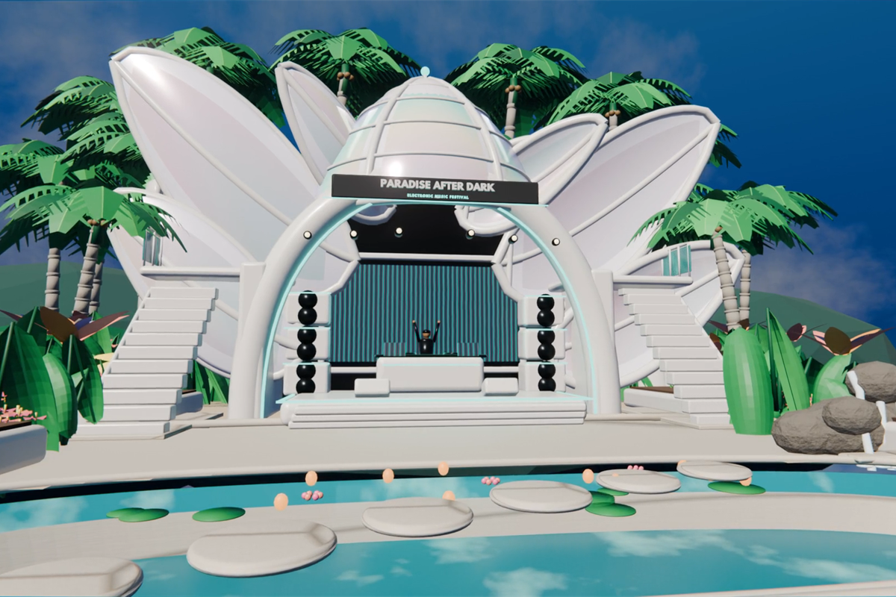
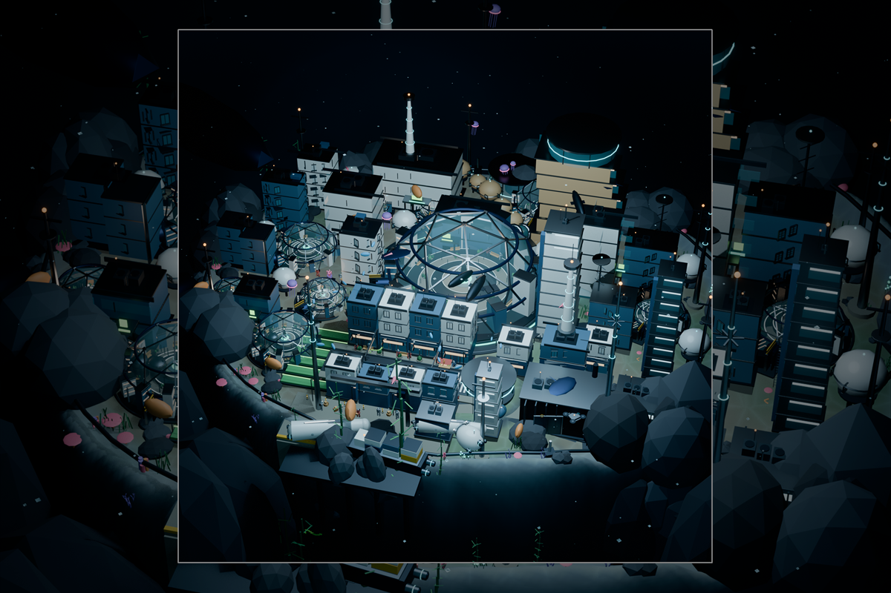
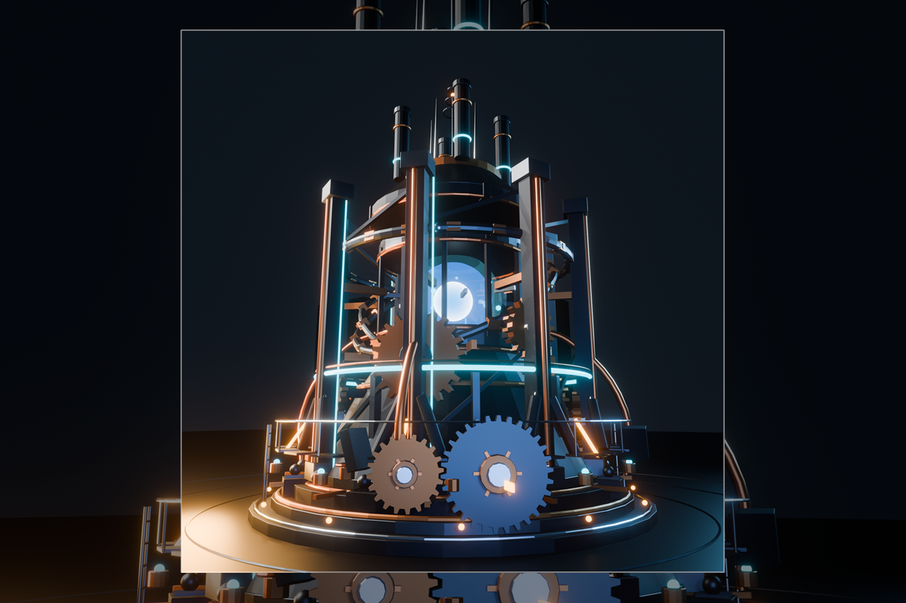
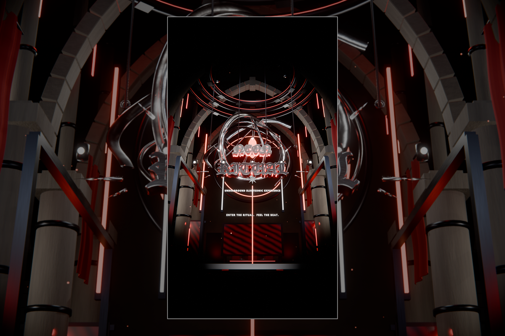
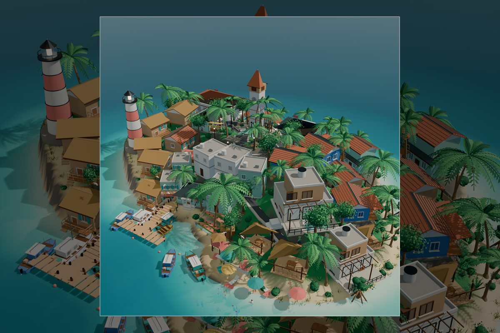

# 3D Model — Blender

Five complete procedural Blender productions, built end-to-end in **Blender 5.2.3 LTS**
with the Blender Python API / Blender MCP bridge. No external asset packs, no image
planes, no pre-rendered backgrounds — the geometry, materials, lighting, cameras and
animation are all built in Blender.

## Latest

**Paradise After Dark** is a 15-second tropical futurism festival courtyard: a white
lotus pavilion with pearl ribs and iridescent glass, a central stage and LED wall, a
turquoise lagoon with caustics and stepping stones, a rock waterfall, and layered
palms. One continuous camera orbit from the pool to the stage, 1920 × 1080 at 30 fps.
[Watch the MP4](Paradise%20After%20Dark/PARADISE_AFTER_DARK_15s.mp4).

## Selected captures

| | |
|:--:|:--:|
|  |  |
|  |  |

The covers are curated 1200 × 800 gallery cards in [`covers/`](covers). Full
render sets stay inside each project folder.

## Projects

### [Abyssal Living City](Abyssal%20Living%20City)

Static underwater civilization: a domed abyssal city on a procedural seabed, with a
high street, districts, coral, kelp, fauna, figures, submarines, signal towers and a
foreground shelf. EEVEE, AgX, 1920 × 1920 hero render.

- 789 objects · 3.05 M triangles · 13 cameras · 18 lights
- Deliverables: `.blend`, final PNG, build script, project notes
- Renders and checkpoints are included.

### [Giant Energy Reactor](Giant%20Energy%20Reactor)

A giant hard-surface energy reactor: luminous core, energy shell, containment rings,
structural frame, stacks and chamber. EEVEE, AgX, 1920 × 1920 hero render.

- 695 objects · 57.7 k triangles
- Deliverables: `.blend`, final PNG, `build_reactor.py`, project notes

### [Neon Ritual](Neon%20Ritual)

A 15-second vertical 3D event advertisement for an underground electronic experience.
A chrome ribbon sculpture, a three-ring orbital structure, a gothic-industrial
cathedral, custom blackletter typography, a rain-wet stage, volumetric light, original
synthesized audio and eight camera shots. The on-screen title is **NEON RITUAL**.

- 717 objects · 304.6 k triangles · 8 cameras · 80 lights
- 1080 × 1920 · 30 fps · 450 frames · 15.0 s
- H.264 High / AAC 192 kb/s MP4
- Deliverables: `.blend`, final MP4, build/animation/render scripts, audio WAVs,
  HD preview stills, production notes
- The 450 PNG intermediate frames (`Neon Ritual/frames/`) are intentionally not
  versioned; the final MP4 is included.

### [Tropical Island Civilization](Tropical%20Island%20Civilization)

A static miniature tropical island town: procedural terrain and ocean, palms and
vegetation, ten building archetypes, people, animals, vehicles, boats, harbour and
farm. Includes a final render plus fast and HQ orbit review videos.

- Deliverables: `.blend`, final PNG, orbit MP4s, modular build scripts, project notes

### [Paradise After Dark](Paradise%20After%20Dark)

A 15-second tropical futurism festival courtyard: a white organic lotus pavilion with
pearl ribs and iridescent glass, a central stage/LED wall, a turquoise lagoon with
caustics and stepping stones, a rock waterfall, and layered palms, monstera, banana,
bird of paradise, heliconia and croton. One continuous 15 s camera orbit from the
pool to the stage. EEVEE, AgX, 1920 × 1080, 30 fps.

- 691 objects · 33 materials · 19 mm camera · 15 s / 450 frames
- 1920 × 1080 · 30 fps · H.264 High MP4, silent
- EEVEE animation recipe: 16 samples, screen-space raytracing, sun-only shadows;
  450 frames rendered in 13m 12s
- Deliverables: `.blend` (still + 15 s), final MP4, poster, two hero stills, build/
  animation/render scripts, project notes
- The planar reflection probe is for stills only; it is disabled for the animation
  because re-baking it per frame costs about 10×.

## Repository notes

- Each project folder is self-contained: `.blend`, source scripts, notes and renders.
- `*.blend1` Blender backups and `__pycache__`/`*.pyc` files are excluded.
- `Neon Ritual/frames/` is excluded because it is a regenerable 817 MB PNG sequence;
  `NEON_RITUAL_FINAL.mp4` is the delivered video.
- `Paradise After Dark/visual reference/` and the local benchmark/diagnostic renders
  are excluded; the final MP4, poster, stills, `.blend` files and pipeline scripts
  are included.
- `Paradise After Dark/PARADISE_AFTER_DARK_15s.mp4` is a silent 15 s H.264 cut.
- Event details in Neon Ritual are intentionally placeholders, not a real event.
- Selected covers are in `covers/`; full render sets are in each project folder.

## Requirements

- Blender 5.2.3 LTS (EEVEE + Cycles)
- Python 3.13 (bundled with Blender)
- ffmpeg only if re-encoding the Neon Ritual video; the Paradise After Dark MP4 is
  encoded directly by Blender.

The project notes in each folder document the exact scene structure, materials,
lighting, camera setup, render settings and known limitations.
